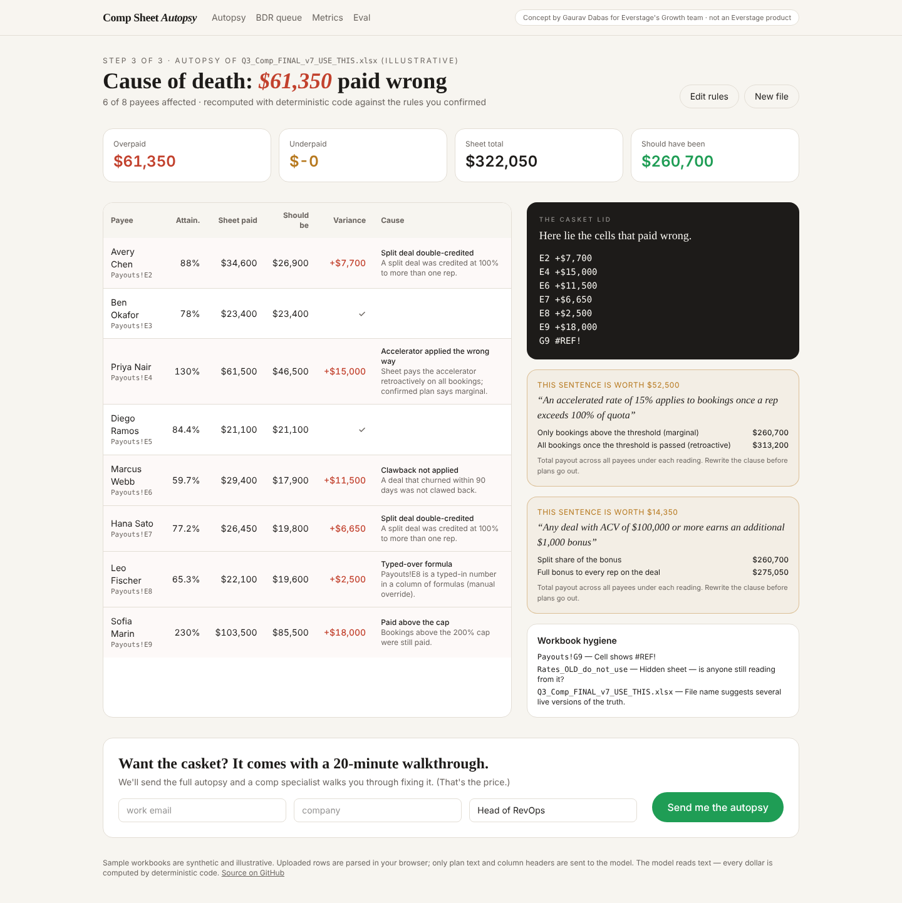

# Comp Sheet Autopsy

**Drop a commission spreadsheet. Every payout is recomputed with deterministic code and reconciled against what the sheet actually paid. You get the cells that paid wrong, in dollars, plus the price of every ambiguous clause in the plan. A qualified lead then lands in a BDR queue with the follow-up already drafted.**

> A concept built by **Gaurav Dabas** for Everstage's Growth team as part of a Growth Engineer application. **This is not an Everstage product.** It uses no Everstage logo or data. All sample workbooks are synthetic and labelled *illustrative*.

Live: _(added at deploy)_ · Video: _(added after recording)_



## The alpha
- **The problem:** most mid-market software companies still run commissions in spreadsheets. Everstage's own survey, which is vendor-sourced, says 60% of US software firms do. Everstage's "Funeral of the Spreadsheet" campaign already speaks to that pain, but it offers a *generic* booklet.
- **The build:** make it *personal*. In about two minutes a RevOps lead sees which cells in **their** sheet paid the wrong amount, why, and how much a vague sentence in their plan is worth.
- **Then do the last mile instead of adding homework:**
  - a rule-based qualifier decides whether the lead goes to a BDR;
  - the BDR gets a HubSpot-shaped task (a mock payload);
  - Claude drafts the first email from aggregated findings;
  - the BDR approves it or edits it, and every edit is logged with a reason.

| Step | Who does it | Why |
|---|---|---|
| Read the plan wording and map columns | **Claude** (structured tool output, Zod-validated, source quote per rule) | Reading prose is what models are good at |
| Confirm or correct the rules | **Human** (edits logged) | Judgement |
| Recompute payouts, reconcile, diagnose cause, price ambiguity | **Deterministic TypeScript** | Money is never computed by a model ("governed math") |
| Qualify and route | **Rule** (thresholds in `engine.ts`) | If the answer can be written as a rule, a person shouldn't be deciding it |
| Draft the first email | **Claude**, from aggregated, name-free findings | Saves the BDR the blank page |
| Send or edit | **BDR** (edit + reason logged) | Edit rate tells us whether the draft knows what "good" is |

## Architecture
```
Browser ─ SheetJS parses .xlsx locally (rows never leave the device)
   │  plan text + header row only
   ▼
/api/extract ── Claude (tool-use JSON schema) ── Zod ──► rules + quotes + column map + ambiguities
   │
Browser ─ engine.ts (pure, deterministic): credit → attainment → tiers/cap/clawback/splits/SPIFFs
        → reconcile vs. sheet → diagnose cause by replaying known spreadsheet mistakes
        → price each ambiguity (run both readings) → hygiene (#REF!, hidden tabs, typed-over formulas)
   │  aggregated findings only
   ▼
/api/opener ── Claude drafts BDR email ──► BDR queue (approve / edit + reason)
/api/events ── funnel, edit rate, failure rate, latency ──► /metrics   (Supabase if configured, else in-memory)
```
**Stack:** Next.js 15 (App Router, TypeScript), Tailwind, SheetJS, Anthropic SDK, Zod, Vitest, deployed on Vercel.

**Real vs mocked:**
- **Real:** LLM extraction and drafting, the engine, the reconciliation, the event logging and the metrics.
- **Mocked or synthetic:** the HubSpot write (the payload is shown, not sent), the sample workbooks, and the BDR queue store (browser local storage).
- **Cached:** if the model is unreachable, the bundled sample uses a cached reading of its plan, and the UI badges it as cached.

## Proof it works
- `npm test` runs 8 unit tests with **hand-computed** expected payouts: marginal vs retroactive accelerators, the cap, clawback, split credit, SPIFF share, and an inclusive tier boundary.
- `npm run eval` runs 3 illustrative workbooks, one of them a clean control, against 12 planted defects:
  - **12/12 recovered, 0 false flags, identical output on re-run.** The `/eval` page shows the same results.
  - Caveat: this tests the engine and diagnosis with known rules. It is a regression test, not proof of real-world accuracy. Live accuracy is measured by user rule-corrections and disputed findings.

## How we'd know it worked (built into `/metrics`)
- **North star:** SQLs per 100 completed autopsies, compared with the current gated ROI-report CTA.
- **Leading metrics:**
  - upload rate on the CTA;
  - completion rate;
  - **opener edit rate**: some edits is healthy; full rewrites mean the prompt is broken;
  - edit reasons. Any reason that appears in more than 30% of edits goes back into the prompt.
- **Guardrails:** extraction failure rate, findings disputed by users, and the rate of full rewrites.
- **Plan:**
  - **Step 0:** a 2-week fake-door test of upload willingness. This is the riskiest assumption.
  - **Step 1:** a sequential holdout against the ROI-report CTA, with the sample size set from the real baseline.
  - **Off-switch test:** pause the BDR hand-off for two weeks. If nobody asks for it back, it wasn't working.
- **Kill if** upload intent stays under the agreed threshold, or the Autopsy's SQL rate doesn't beat the control at the agreed sample size.

## Run it
```bash
npm install
cp .env.example .env.local   # ANTHROPIC_API_KEY=...  (optional: ANTHROPIC_MODEL, SUPABASE_URL, SUPABASE_SERVICE_KEY)
npm run dev                  # http://localhost:3000
npm test && npm run eval
npm run samples              # regenerate the illustrative workbooks
```
Optional Supabase table: `create table events (id bigserial primary key, type text, session_id text, props jsonb, ts timestamptz default now());`

## What I'd do at Everstage
- **Week 1:**
  - put the fake-door CTA on the spreadsheet-funeral page and agree the SQL baseline and kill threshold with Growth;
  - wire the real HubSpot task creation;
  - run the reader on 20 anonymised plans from closed-won deals to measure correction rate before any traffic.
- **Month 1:**
  - ship behind the holdout;
  - feed BDR edit reasons back into the prompt every week;
  - connect it to the casket mailer: the lid prints the prospect's own dead cells;
  - review with Sales whether Autopsy leads convert differently;
  - kill it or scale it on the numbers.
- **Later:**
  - read plans through the Everstage MCP server, or hand off to Eva Plan Builder, so a qualified Autopsy becomes the PoC configuration;
  - the same engine prices plan ambiguity during comp-plan design season (Oct–Nov).

## Limits (v1)
- One plan per workbook.
- Supported plan rules: tiers (marginal or retroactive), cap, clawback, split credit, flat SPIFFs. Draws, MBOs, manager overrides and quarterly true-ups are not modelled yet.
- The workbook needs a Plan / Deals / Payouts structure; the column mapping is editable in the UI.
- PDF plans are not supported.
- SheetJS is the community npm build (0.18.5). It only parses files locally in the user's own browser.
